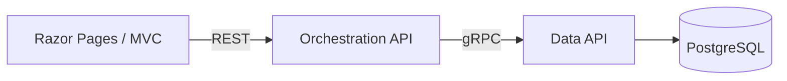
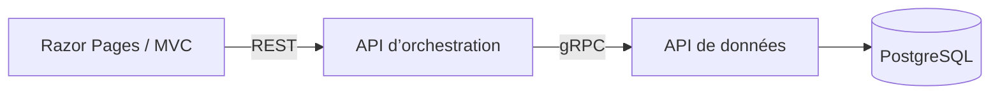

# Hello! $\textsf{\color{gray}{(English)}}$

Bilingual (English / French) software engineer with 14+ years building production systems in C# and .NET — REST APIs, relational & document databases, and cloud services on Azure.

## Featured projects

### 🔷 Containerised Multi-Service Account System *(C# / .NET)*

A containerised account-management application in .NET 10, built as a multi-service system and organised with **Clean Architecture** (Domain / Application / Infrastructure / Presentation layers, dependencies pointing inward):

- Razor Pages / MVC frontend → **Orchestration API** (REST) → **Data API** (gRPC) → PostgreSQL — data access is isolated in its own service so other APIs can reuse it without duplicating database logic, and only that service holds database credentials
- **gRPC** between the APIs with a shared Protocol Buffers contract, deadlines and cancellation propagated down to the database query, and a **server-streaming** RPC that streams an account's transactions row by row without holding the full result in memory
- API-key authentication on every service-to-service call, with a separate key per hop; Swagger / OpenAPI on the REST API; health checks; configuration validated at startup; the Data API connects as a least-privilege database role
- Single repository with one-command start via **Docker Compose**; passwords and keys supplied as **Docker secrets** rather than environment variables
- Unit tests with xUnit, NSubstitute and AwesomeAssertions; integration tests that call the gRPC services in memory against a disposable PostgreSQL container with **Testcontainers**

**Stack:** C#, ASP.NET Core, Razor Pages, MVC, REST, gRPC, Protocol Buffers, PostgreSQL, Npgsql, Docker, xUnit, Testcontainers. Built with Clean Architecture and DDD tactical patterns (typed value objects with validation).

See the **[accounts-system](https://github.com/ElisesHub/accounts-system)** repository.

### 🐍 Energy Readings *(Python / FastAPI · React / TypeScript)*

A FastAPI service for ingesting and querying hourly energy meter readings, built while broadening my stack into Python and data engineering, with a React dashboard in progress:

- Organised by feature (**vertical slice**) with **CQS** — command/query separation — at the folder level
- REST endpoints for ingesting (single + bulk), querying, and daily aggregations
- PostgreSQL with **SQLModel**, validated inputs via Pydantic, full **Docker Compose** setup
- *In progress:* a **React / TypeScript** dashboard (Vite, React Router, TanStack Query) for browsing and charting the readings

**Stack:** Python, FastAPI, SQLModel, PostgreSQL, Docker · React, TypeScript, Vite, TanStack Query.

See the **[energy-readings-api](https://github.com/ElisesHub/energy-readings-api)** and **[energy-readings-web](https://github.com/ElisesHub/energy-readings-web)** repositories.

### Contact

📫 [LinkedIn](https://www.linkedin.com/in/elise-loi)

---

# Bonjour!   $\textsf{\color{gray}{(Français)}}$

Développeuse logicielle bilingue (français / anglais) avec plus de 14 ans d'expérience à concevoir des systèmes en production en C# et .NET — API REST, bases de données relationnelles, services cloud sur Azure.

## Projets phares

### 🔷 Système de gestion de comptes multi-services conteneurisé *(C# / .NET)*

Une application de gestion de comptes conteneurisée en .NET 10, conçue comme un système multi-services et organisée selon les principes de la **Clean Architecture** (couches Domain / Application / Infrastructure / Presentation, dépendances orientées vers l'intérieur) :

- Frontend Razor Pages / MVC → **API d’orchestration** (REST) → **API de données** (gRPC) → PostgreSQL — l'accès aux données est isolé dans un service dédié, réutilisable par d'autres API sans dupliquer la logique d'accès à la base, et seul ce service détient les identifiants de connexion
- **gRPC** entre les API avec un contrat Protocol Buffers partagé, des deadlines et une annulation propagées jusqu'à la requête en base, et un RPC en **streaming côté serveur** qui renvoie les transactions d'un compte ligne par ligne, sans charger le résultat complet en mémoire
- Authentification par clé API à chaque appel entre services, avec une clé distincte par appel ; Swagger / OpenAPI sur l'API REST ; health checks ; validation de la configuration au démarrage ; l'API de données se connecte avec un rôle de base de données à privilèges minimaux
- Dépôt unique avec démarrage en une seule commande via **Docker Compose** ; mots de passe et clés fournis sous forme de **secrets Docker** plutôt que de variables d'environnement
- Tests unitaires avec xUnit, NSubstitute et AwesomeAssertions ; tests d'intégration qui appellent les services gRPC en mémoire, sur un conteneur PostgreSQL jetable avec **Testcontainers**

**Stack :** C#, ASP.NET Core, Razor Pages, MVC, REST, gRPC, Protocol Buffers, PostgreSQL, Npgsql, Docker, xUnit, Testcontainers. Conçu selon la Clean Architecture et avec des patterns tactiques du DDD (value objects fortement typés avec validation).

Voir le dépôt **[accounts-system](https://github.com/ElisesHub/accounts-system)**.

### 🐍 Energy Readings *(Python / FastAPI · React / TypeScript)*

Un service FastAPI pour l'ingestion et l'interrogation de relevés énergétiques horaires, construit en parallèle de l'élargissement de ma stack vers Python et la data engineering, avec un tableau de bord React en cours de développement :

- Organisé par feature (**vertical slice**), avec une séparation **CQS** — command/query separation — au niveau des dossiers
- Endpoints REST pour l'ingestion (unitaire et en masse), l'interrogation, et les agrégations journalières
- PostgreSQL avec **SQLModel**, validation des entrées via Pydantic, déploiement complet via **Docker Compose**
- *En cours :* un tableau de bord **React / TypeScript** (Vite, React Router, TanStack Query) pour parcourir et visualiser les relevés

**Stack :** Python, FastAPI, SQLModel, PostgreSQL, Docker · React, TypeScript, Vite, TanStack Query.

Voir les dépôts **[energy-readings-api](https://github.com/ElisesHub/energy-readings-api)** et **[energy-readings-web](https://github.com/ElisesHub/energy-readings-web)**.

### Me contacter

📫 [LinkedIn](https://www.linkedin.com/in/elise-loi)

---

> *"Every system we create today will one day become a legacy system if it is valuable enough to survive"*
>
> — **Martin Kleppmann**, *Designing Data-Intensive Applications*

---
